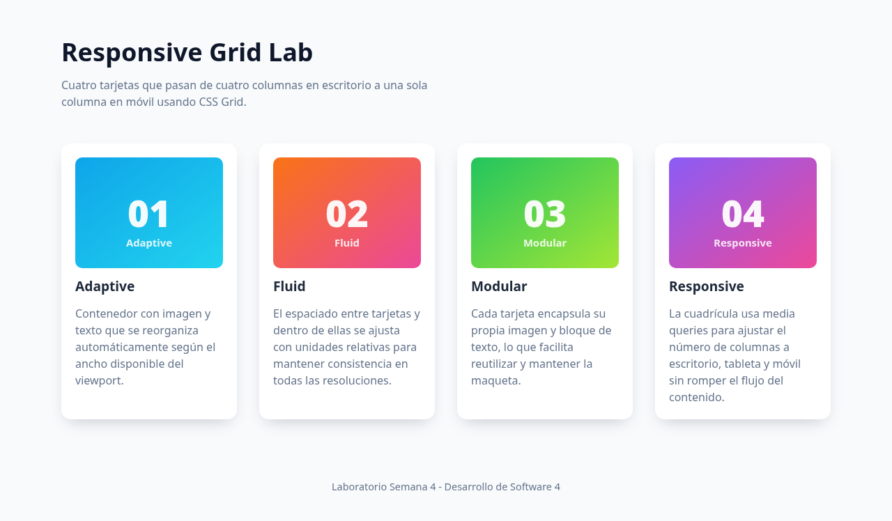
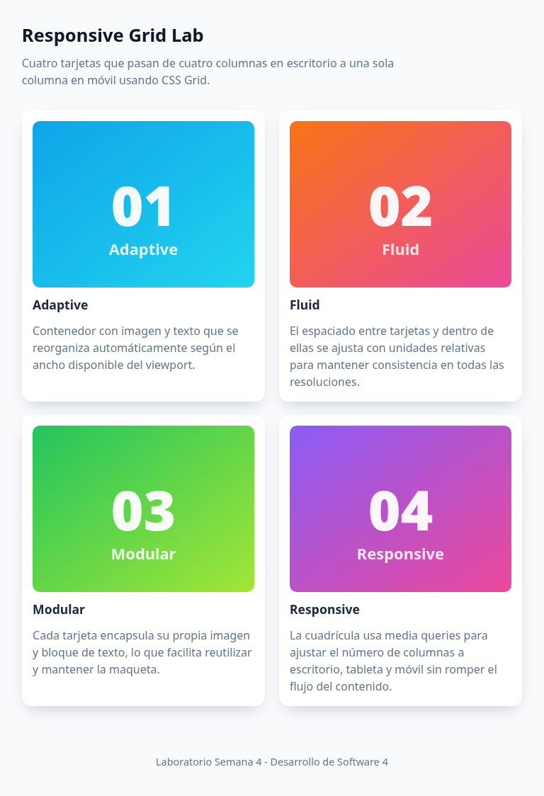
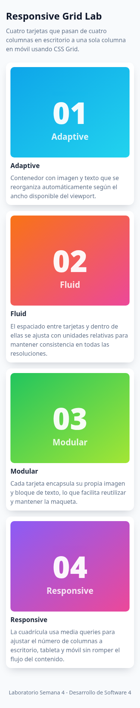

# Laboratorio Semana 4 — Diseño adaptable con CSS Grid

**Estudiante:** Diego Alejandro Botina
**Materia:** Desarrollo de Software 4
**Semana:** 4
**Repositorio (GitLab):** https://gitlab.com/jala-university1/cohort-5/ES.CSSD-245.GA.T2.26.M2/SD/group-b/individual-laboratories/alejandro-botina/week-04/responsive-grid-lab-week-04  
**Repositorio espejo (GitHub):** https://github.com/JalaU-Labs/responsive-grid-lab-week-04  
**Sitio publicado (GitHub Pages):** https://jalau-labs.github.io/responsive-grid-lab-week-04/  
**Sitio publicado (GitLab Pages):** https://responsive-grid-lab-week-04-647b30.gitlab.io/  

## Objetivo

Desarrollar una página web simple con CSS Grid, con un diseño responsivo que se
adapte a escritorio, tableta y móvil, y con contenedores de imagen y texto.

## Descripción de la solución

La página contiene cuatro tarjetas (`article.card`), cada una con una imagen SVG
ilustrativa y un bloque de texto descriptivo. El contenedor `.grid` aplica
`display: grid` con `grid-template-columns: repeat(4, minmax(0, 1fr))` en
escritorio, `repeat(2, minmax(0, 1fr))` en viewports de hasta 1024 px y `1fr` en
viewports de hasta 640 px.

El espaciado se define con `gap` y `padding` basados en `clamp()`, lo que mantiene
una separación consistente entre tarjetas y entre los elementos internos en todas
las resoluciones.

Las pruebas automatizadas con Playwright verifican el número de columnas por
viewport, la presencia de las cuatro tarjetas con imagen, título, texto y `alt`
descriptivo, y que el espaciado del grid y de las tarjetas sea mayor a cero.

## Capturas

### Escritorio (1280 x 720)

### Tableta (768 x 1024)

### Móvil (375 x 667)

## Resultados de las pruebas

- `make lint`: sin errores.
- `make format-check`: `All matched files use Prettier code style!`.
- `make test`: 9 pruebas verdes (3 tests x 3 proyectos: desktop, tablet, mobile).
- `make build`: bundle de producción generado en `dist/` con HTML, CSS, JS y SVG.
- Pipelines de CI/CD: verdes en GitHub Actions y GitLab CI, con despliegue automático
  a GitHub Pages y GitLab Pages.